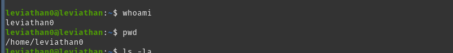

# OverTheWire: Leviathan — Write-ups

## Overview

This repository documents my progress through the [OverTheWire Leviathan](https://overthewire.org/wargames/leviathan/) wargame.

The goal is to practice Linux enumeration, file permissions, SUID binaries, and basic binary analysis in a controlled environment.

## Environment & Tools

- Linux terminal
- SSH
- Basic Linux commands: `whoami`, `pwd`, `ls`, `grep`, `strings`
- `file`
- `ltrace`

> These notes cover the levels I have completed so far. Screenshots are included where available.

---

## Level 0 → Level 1

### 1. Initial Access

Connected to the game server using SSH:

```bash
ssh leviathan0@leviathan.labs.overthewire.org -p 2223
```

Checked the current user, working directory, and directory contents:

```bash
whoami
pwd
ls -la
```

### 2. Enumeration
.png)
The home directory contained a hidden directory named `.backup`.

Relevant directory entry:

```text
drwxr-x--- 2 leviathan1 leviathan0 ... .backup
```

The directory was owned by `leviathan1`, with `leviathan0` as its group.

The group permissions allowed directory traversal and reading its entries.

Inspected the directory:

```bash
ls -la .backup
```

Found a file named `bookmarks.html`.

Its permissions allowed the group to read the file:

```text
-rw-r----- 1 leviathan1 leviathan0 ... bookmarks.html
```

### 3. Targeted Search

Searched the file for potentially relevant terms:

```bash
grep -inE 'password|pass|secret|leviathan|login' .backup/bookmarks.html
```
.png)
The search revealed a bookmark containing the next level's password.

**Finding:** Sensitive information was exposed in a readable HTML bookmark file.

The credential is intentionally omitted from this public write-up.

### 4. Result

Used the discovered credential to authenticate as `leviathan1` over SSH.

**Key takeaway:** Hidden files and readable backups can expose sensitive information. File and directory permissions should be reviewed carefully.

---

## Level 1 → Level 2

### 1. Enumeration

After connecting as `leviathan1`, listed the home directory:

```bash
ls -la
```
.png)

Found an executable named `check`:

```text
-r-sr-x--- 1 leviathan2 leviathan1 ... check
```

The file was owned by `leviathan2` and had the SUID permission bit set.

### 2. File Analysis

Identified the file type:

```bash
file check
```
.png)

The output identified it as a 32-bit ELF executable with SUID enabled.

Extracted readable strings:

```bash
strings check
```

Relevant strings included:

```text
getchar
strcmp
setreuid
system
/bin/sh
password:
Wrong password, Good Bye ...
```

These strings suggested that the program accepted input, compared strings, and could invoke a shell.

### 3. Dynamic Analysis

Executed the program to observe its behavior:

```bash
./check
```

An incorrect input produced a password error.

Used `ltrace` to observe library calls:

```bash
ltrace ./check
```

The trace showed a comparison similar to:

```text
strcmp("hwl", "sex") = -1
```

This indicated that the input read by the program was compared with the string `sex`.

### 4. Validation

Entered the expected string when prompted by the program.

The program opened a shell. Verified the resulting identity with:

```bash
whoami
id
```

The output confirmed that the shell was running with the user identity `leviathan2`.

### 5. Security Finding

The SUID executable provided a path to a shell running with its owner's identity after the input check succeeded.

**Impact:** A user who could execute the binary could access a shell with the privileges associated with `leviathan2`.

**Defensive lesson:** SUID programs should avoid launching shells unnecessarily, minimize privileges, and validate authorization securely.

---

## Lessons Learned

- Enumerate directories and permissions before attempting exploitation.
- Use `grep` to search large text files efficiently.
- Use `file` and `strings` to gather initial information about executables.
- Use `ltrace` to inspect library calls and understand program behavior.
- Verify privilege changes with `whoami` and `id`.
- Document the finding, its impact, and defensive recommendations.

## Disclaimer

All testing documented here was performed within the authorized OverTheWire Leviathan training environment.

This repository is intended for educational purposes.
